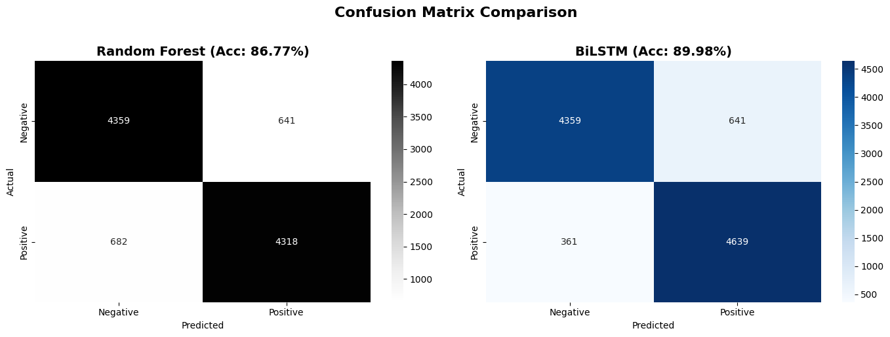
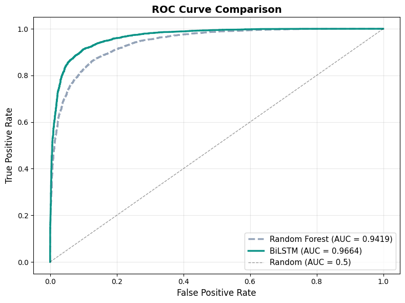
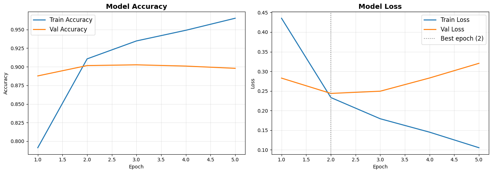

# Amazon Review Sentiment Analysis

**Classifying product reviews as positive or negative, and measuring what a Bidirectional LSTM adds over a bag-of-words baseline**

AI & Machine Learning module (BDA25706) · MSc Business & Data Analytics · Ravensbourne University London · 2026


[](https://colab.research.google.com/github/simanta-karmaker/amazon-review-sentiment/blob/main/notebooks/sentiment_analysis_bilstm.ipynb)

<p align="center">
  
</p>

## Overview

Online reviews are unstructured text, and reading them at scale is slow and inconsistent. This project builds an end-to-end pipeline that turns raw review text into a sentiment prediction: data collection, cleaning, tokenisation, a Bidirectional LSTM, evaluation on held-out reviews, error analysis and a live inference demo.

The model is compared with a TF-IDF + Random Forest baseline trained and tested on **exactly the same reviews**, so the comparison shows what modelling word order adds over a bag of words.

The data are 100,000 reviews (50,000 positive, 50,000 negative) sampled from the 3.6 million training reviews of the Amazon Review Polarity dataset, split 80 / 10 / 10 into training, validation and test sets, stratified by sentiment.

## Key findings

- **Modelling word order adds about 3 points.** On the same 10,000 held-out reviews, the BiLSTM reaches 90.0% accuracy (ROC AUC 0.966) and the TF-IDF + Random Forest baseline 86.8% (ROC AUC 0.942). With 10,000 test reviews each accuracy is precise to about ±0.6–0.7 points (95% interval), so the gap is real, but most of the signal is already in which words a review uses.
- **The whole gain is on positive reviews.** Both models label 641 of the 5,000 negative test reviews as positive; the difference is that the BiLSTM misses 361 positive reviews and the baseline 682. The BiLSTM therefore leans positive (it recognises 92.8% of positive reviews but 87.2% of negative ones), while the baseline's errors are balanced. Given the BiLSTM's high ROC AUC, a tuned decision threshold could even out its two error types.
- **Negation is not solved.** "This is not good at all." was labelled positive (62.5% confidence) and "Not bad at all, actually really useful." negative (87.0%). Two examples are not a test, but they show that reading the sequence does not by itself make the model handle negation.
- **Some errors are label noise.** The most confident mistakes include reviews whose words are clearly positive but whose star rating was low, such as a "100 percent satisfied" review labelled negative, and reviews that praise most of a product but give it 2 stars.
- **Early stopping mattered.** Validation loss was lowest after epoch 2. Over the next three epochs training accuracy rose from 91.1% to 96.5% while validation loss climbed from 0.24 to 0.32, so training stopped and the epoch-2 weights were kept.

| Model (same 10,000 test reviews) | Accuracy | F1 (weighted) | ROC AUC | PR AUC |
|---|---|---|---|---|
| TF-IDF + Random Forest | 86.8% | 0.868 | 0.942 | 0.942 |
| Bidirectional LSTM | **90.0%** | **0.900** | **0.966** | **0.966** |

<p align="center">
  
</p>
<p align="center">
  
</p>

## Approach

| Step | What was done |
|---|---|
| Data | Amazon Review Polarity (Zhang, Zhao and LeCun, 2015): reviews rated 1–2 stars are negative, 4–5 stars positive, 3-star reviews excluded. A balanced random sample of 100,000 reviews; title and body combined. |
| Cleaning | HTML tags, URLs, email addresses, digits and punctuation removed; text lowercased. |
| Split | One stratified 80 / 10 / 10 split into 80,000 training, 10,000 validation and 10,000 test reviews, made before anything is fitted and shared by both models. |
| Features | BiLSTM: the 25,000 most frequent words in the training reviews, each review padded or truncated to 150 tokens. Baseline: TF-IDF on unigrams and bigrams (25,000 features), fitted on the training reviews. |
| BiLSTM | Embedding (25,000 × 128) → spatial dropout (0.3) → Bidirectional LSTM (128 units each way) → global max pooling → dense layers (64, 32) with dropout → sigmoid output. 3,481,729 trainable parameters. Adam (learning rate 0.001), binary cross-entropy, batch size 256, early stopping on validation loss (patience 3) and learning-rate halving (patience 2). |
| Baseline | Random Forest with 300 trees on the TF-IDF features. |
| Evaluation | Accuracy, precision, recall, F1, ROC AUC and PR AUC on the test reviews; confusion matrices; error analysis showing the text of misclassified reviews; short negation probes. |

## Limitations and next steps

- **One run, one random seed.** The scores come from a single training run, so small differences between models should not be over-read.
- **Two classes only.** Neutral 3-star reviews are excluded and mixed opinions are forced into positive or negative.
- **Domain.** English Amazon reviews only; performance on other platforms or languages is untested.
- **Stronger comparisons.** A linear TF-IDF model (logistic regression) and a fine-tuned pre-trained transformer such as DistilBERT are the natural next baselines.
- **Responsible use.** Sentiment scores used to prioritise customers should keep a human in the loop, and processing review data in production must respect UK GDPR.

## Repository structure

```
notebooks/sentiment_analysis_bilstm.ipynb   full analysis with outputs (sections 1–11)
figures/                                    charts exported from the notebook
results.json                                test-set metrics for both models, exported by the notebook
requirements.txt                            Python packages for running the notebook
```

## Running the notebook

Open the notebook in Google Colab with the badge above, choose a GPU under **Runtime → Change runtime type**, then **Runtime → Run all**. The dataset is downloaded from Kaggle with `kagglehub` while the notebook runs (the training file alone is about 1.5 GB). The published run took about 35 minutes on a free T4 GPU runtime, 21 of them training the BiLSTM; on a CPU-only runtime training is several times slower. To run it elsewhere, install the packages with `pip install -r requirements.txt`.

## Data

The Amazon Review Polarity dataset was built by Zhang, Zhao and LeCun (2015) from Amazon reviews collected by McAuley and Leskovec (2013). It is downloaded at run time from Kaggle ([`kritanjalijain/amazon-reviews`](https://www.kaggle.com/datasets/kritanjalijain/amazon-reviews)) and is not redistributed here. The notebook prints short excerpts of reviews only in its examples and error analysis.

## Notes on this version

This is a cleaned version of the notebook submitted for the module:

- The baseline now uses the same train / test split as the BiLSTM. In the coursework version, the baseline's texts were taken in their original row order while its labels came from the shuffled split, so they did not match and the baseline scored at chance level.
- The tokeniser's vocabulary is now learned from the training reviews only; it was previously fitted on all 100,000 reviews.
- The error analysis now prints the text of misclassified reviews.
- The interactive input demo was replaced by a fixed list of examples, so the notebook runs from start to finish.

## Author

**Simanta Karmaker** · MSc Business & Data Analytics (Distinction), Ravensbourne University London · individual project

See also: [corridor-environmental-compliance](https://github.com/simanta-karmaker/corridor-environmental-compliance), my MSc dissertation on predicting environmental-standard exceedances.

## References

- McAuley, J. and Leskovec, J. (2013) 'Hidden factors and hidden topics: understanding rating dimensions with review text', *Proceedings of the 7th ACM Conference on Recommender Systems*, pp. 165–172.
- Schuster, M. and Paliwal, K.K. (1997) 'Bidirectional recurrent neural networks', *IEEE Transactions on Signal Processing*, 45(11), pp. 2673–2681.
- Zhang, X., Zhao, J. and LeCun, Y. (2015) 'Character-level convolutional networks for text classification', *Advances in Neural Information Processing Systems*, 28, pp. 649–657.

## Licence

The code is released under the [MIT Licence](LICENSE). The review data are not included.
